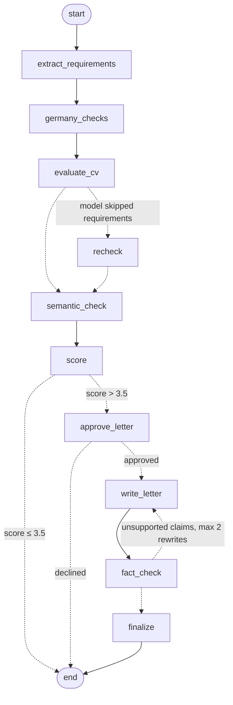

# 🎯 AI - CV ↔ Job Matcher

A local AI tool that compares your CV with a job description, gives you a **match score out of 5**
and, when the score is **above 3.5**, writes a tailored **cover letter** in the language of the job ad.
By default it runs entirely on your own computer with [Ollama](https://ollama.com), so your CV never leaves your machine.

The pipeline is an agentic workflow built with **LangGraph** and **LangChain**: a state graph with
conditional routing, a human-in-the-loop pause, a self-correcting cover-letter loop and saved checkpoints.

## Features

| | Feature |
|---|---|
| 🧮 | **Hybrid scoring**: AI judgement + requirement checklist + semantic similarity (embeddings) + ATS keyword coverage |
| ✅ | **Must-have vs nice-to-have**: every missing must-have costs 0.25 points (max 1.0) |
| 🇩🇪 | **Germany checks**: required German level (CEFR) vs yours, Werkstudent/part-time/full-time, weekly hours vs the usual 20 h student limit |
| 🛡️ | **Anti-hallucination**: the AI must quote evidence from your CV; claims it can't support are downgraded |
| 🔁 | **Self-correcting letters**: every draft is fact-checked against your CV and rewritten automatically (max 2×) if it claims something unsupported |
| ⏸️ | **Human-in-the-loop**: the graph pauses after scoring and writes the letter only when you say so |
| 🔀 | **Model picker**: local Ollama by default, or OpenAI / Anthropic / OpenRouter with your own API key |
| 🧭 | **Pipeline trace**: a local log of every step (node, duration, result) — no cloud tracing |
| ✍️ | **CV tailoring**: rewrites of your existing CV lines for the specific job (nothing invented) |
| ✉️ | **Cover letter**: formal/modern tone, short/standard/detailed, extra instructions, edit in the app, export **DOCX / PDF (DIN 5008)** / TXT |
| 💾 | **Saved CV**: upload once, then just paste job ads |
| 📋 | **Application tracker**: every analysis saved (SQLite) with status, notes and CSV export |

### How the score works

```
skills     = 50% AI + 30% requirement checklist + 20% semantic similarity
experience = AI          education = AI
languages  = AI, capped if the job's German level is above yours
keywords   = share of the ad's ATS keywords that appear in your CV

overall = 35% skills + 25% experience + 15% languages + 15% education + 10% keywords
          − 0.25 per missing must-have (max 1.0)
cover letter if overall > 3.5
```
Weights and thresholds are in `matcher/config.py`.

## Architecture (LangGraph)



| Node | Type | What it does |
|---|---|---|
| `extract_requirements` | LLM | Job ad → must-haves, nice-to-haves, ATS keywords (structured output) |
| `germany_checks` | rules | Ad language, required German level, job type, weekly hours |
| `evaluate_cv` | LLM | Verdict + quoted evidence per requirement, category scores |
| `recheck` | LLM | Asks again for requirements the model skipped (max 1×) |
| `semantic_check` | embeddings | Similarity of each requirement to the CV (`nomic-embed-text`) |
| `score` | rules | Verifies evidence, applies keyword/degree rules, computes the 0–5 score |
| `approve_letter` | human | `interrupt()` — the run is checkpointed and waits for your decision |
| `write_letter` | LLM | Cover letter with strict fact rules (tone, length, extra instructions) |
| `fact_check` | rules | Finds claims the CV doesn't support → routes back to `write_letter` |
| `finalize` | rules | Keeps the draft with the fewest issues |

- **LangChain**: `ChatOllama` + `OllamaEmbeddings`, `ChatPromptTemplate`, and `with_structured_output` with
  Pydantic models (`matcher/schemas.py`), so Ollama enforces the JSON schema while generating.
- **Checkpoints**: `SqliteSaver` stores every step in `data/graph_checkpoints.db`; a paused run can be
  resumed after restarting the app.
- **Thinking models** (Qwen3 / 3.5, DeepSeek-R1) are detected automatically and run with thinking off.

## Setup on Windows (one time)

1. **Install Python 3.11+** from python.org (tick *“Add python.exe to PATH”*).
2. **Install Ollama for Windows** from https://ollama.com/download and start it.
3. **Download the models** (in PowerShell):
   ```powershell
   ollama pull qwen2.5:7b
   ollama pull nomic-embed-text
   ```
   `qwen2.5:7b` (~4.7 GB) fits a 6 GB GPU and handles German well. `nomic-embed-text` (~270 MB) powers the semantic check.
4. **Create the environment** in the project folder:
   ```powershell
   cd "C:\Users\<you>\MyProjects\cv-job-matcher"
   python -m venv .venv
   .venv\Scripts\activate
   pip install -r requirements.txt
   ```

## Run

```powershell
.venv\Scripts\activate
streamlit run app.py
```
or double-click **`run.bat`**. The app opens at http://localhost:8501.

First use:
1. **My profile** → name, address, place, German level, student status, hours you already work elsewhere, availability.
2. **Analyse** → upload your CV (PDF, text-based) once, paste a job ad, click **Analyse match**.
3. Check the breakdown, Germany checks and requirements → **Suggest CV rewrites** → **Generate cover letter** → download.
4. **Tracker** → update status (applied / interview / …) and notes; export CSV.

The first analysis takes longer while the model loads into memory.

## Choosing a model

Pick the provider and model in the sidebar. The choice is remembered.

| Provider | Needs | Notes |
|---|---|---|
| **Ollama (local)** — default | Ollama running | Free and private. The dropdown lists your installed models. |
| **OpenAI** | `OPENAI_API_KEY` | Paid per use. |
| **Anthropic** | `ANTHROPIC_API_KEY` | Paid per use. |
| **OpenRouter** | `OPENROUTER_API_KEY` | One key for many models; type any `vendor/model` name. Prefer models that support structured outputs. |

**API keys** go into a `.env` file in the project folder (copy `.env.example` to `.env`). `.env` is git-ignored.

```
OPENAI_API_KEY=sk-...
```

**Privacy:** with a cloud provider, your CV text and the job ad are sent to that provider. The app asks you
to confirm this once per provider. Embeddings (the semantic check) always stay local on Ollama; if Ollama is
not running, that check is skipped.

The suggested model names live in `PROVIDERS` in `matcher/config.py` — edit them when new models come out.
For Ollama you can also set a default with `$env:CVM_CHAT_MODEL = "llama3.1:8b"`.
Other settings: `OLLAMA_HOST`, `CVM_EMBED_MODEL`, `CVM_NUM_CTX`, `CVM_DATA_DIR`, `CVM_THINK`, `CVM_TIMEOUT`.

## Tests

```powershell
python -m pytest -q
```
Tests use a fake model and a fake Ollama server, so they run without Ollama.

## Project structure

```
cv-job-matcher/
├── app.py                 # Streamlit UI (Analyse / Tracker / My profile)
├── matcher/
│   ├── graph.py           # LangGraph state machine: nodes, routing, interrupt
│   ├── pipeline.py        # runs the graph: analyse → pause → write letter; checkpoints
│   ├── chains.py          # LangChain chains: prompt | structured output
│   ├── schemas.py         # Pydantic models for every LLM answer
│   ├── prompts.py         # all prompt texts
│   ├── llm.py             # model providers: Ollama, OpenAI, Anthropic, OpenRouter
│   ├── config.py          # weights, thresholds, loop limits, providers and model names
│   ├── pdf_reader.py      # CV text extraction
│   ├── germany.py         # rule-based German-market checks
│   ├── textutils.py       # keyword matching, chunking, cosine similarity
│   ├── scorer.py          # scoring rules (pure Python, no LLM calls)
│   ├── tailor.py          # CV rewrite suggestions
│   ├── cover_letter.py    # letter inputs, clean-up and fact check
│   ├── export.py          # DOCX / PDF in DIN 5008 layout
│   └── storage.py         # SQLite: profile, CV, applications
├── tests/
└── data/                  # your local databases (git-ignored)
```

## Privacy

Everything (CV, profile, applications, graph checkpoints) is stored in `data/` on your computer and is git-ignored.
With the default local model, no data is sent anywhere except to your local Ollama server. If you choose a
cloud provider, the CV and job ad are sent to that provider (after you confirm). LangSmith tracing is not used.

## Roadmap (v2)

Batch mode with ranked jobs · job description from URL · interview prep questions · radar-chart dashboard ·
Docker · CI.

## License

MIT
